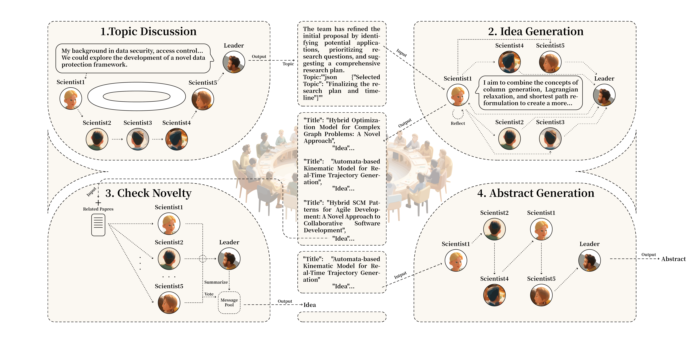

<p align="center">
  
</p>


# Dynamic Knowledge Exchange and Dual-diversity Review: Concisely Unleashing the Potential of a Multi-Agent Research Team.

## 👀 Introduction

This repository contains the code for our paper `Dynamic Knowledge Exchange and Dual-diversity Review: Concisely Unleashing the Potential of a Multi-Agent Research Team`(https://arxiv.org/abs/2506.18348). 

## 💡 Run

### Environment

Tested the codebase with PyTorch 2.3.1 and CUDA 12.1. Please install the corresponding versions of PyTorch and CUDA based on your computational resources.

To install the required packages, run:

```bash
pip install -r requirements.txt
```

#### Note

If you encounter any errors while setting up the environment, do not panic, as our environment is deployed on the ARM architecture, which may cause some package versions to be unavailable. The most important thing is to install agentscope in `editable mode` 😀, which can be easily installed using the command:

```
cd agentscope-main
pip install -e .
```

### Setup

#### Computer Sciences Dataset
The Computer Sciences raw data is based on the [AMiner Computer Science Dataset](https://www.aminer.cn/aminernetwork).

After preprocessing, the used data is publicly available at [Google Drive](https://drive.google.com/drive/folders/1ZwWMBQ5oK-l4VuzMa60GbMND0g2EIxIu?usp=sharing).

- Past paper database is put in the `Papers/papers.tar.gz`, which is used in `paper_folder_path` of Line 34 in `sci_platform/sci_platform.py`. The corresponding embedding database is put in the `Embeddings/faiss_index.index`, which is used in `cpu_index` of Line 158 in `sci_platform/sci_platform.py`.

- Contemporary paper database is put in the `Papers/papers_future.tar.gz`, which is used in `future_paper_folder_path` of Line 35 in `sci_platform/sci_platform.py`. The corresponding embedding database is put in the `Embeddings/faiss_index_future.index`, which is used in `cpu_future_index` of Line 162 in `sci_platform/sci_platform.py`.

- Author knowledge bank is put in the `Authors/books.tar`, which is used in in `input_dir` of Line 13 in `sci_platform/configs/knowledge_config.json` and `author_info_dir` of Line 36 in `sci_platform/sci_platform.py`.

- Adjacency matrix is put in the `adjacency.txt`, which is used in `adjacency_matrix_dir` of Line 37 in `sci_platform/sci_platform.py`.

#### Health Sciences Dataset

The raw data in Health Sciences was extracted from [Pubmed](https://pubmed.ncbi.nlm.nih.gov/), a database maintained by the [NCBI](https://www.ncbi.nlm.nih.gov/books/NBK25501/). 

After preprocessing, the used data is publicly available at [Google Drive](https://drive.google.com/file/d/1AedrqqaGgml7ExGGWBGmST413JSZ3jzF/view?usp=drive_link).

- The usage of this dataset is similar to that of the Computer Sciences dataset mentioned above.

#### Note

Please replace all paths in `sci_platform/sci_platform.py` with your own settings after download the data.

### Code

Here we explain the roles of several critial files.

- `agentscope-main/src/agentscope/agents/sci_agent.py` defines the customized scientist agent in this project.

- `sci_platform/run.py` is the main execution file.

- `sci_platform/sci_platform.py` defines the platform for the initialization of our multi-agent system.

- `sci_platform/utils/prompt.py` contains all the prompts used.

- `sci_platform/utils/scientist_utils.py` contains all the common functions used.

- `sci_platform/sci_team/SciTeam.py` defines the execution mechanism of each scientist team.

### Usage

#### Ollama

In our experiments, we use `ollama` to deploy the `llama3.1-8b`,`llama3.1-70b` and `QWQ` model. The details of deployment could refer to [URL](https://github.com/modelscope/agentscope/blob/main/scripts/README.md#ollama).

1. Ollama should be installed. The linux version:

```
curl -fsSL https://ollama.com/install.sh | sh
```

2. Run ollama in the path where ollama is installed:

```
./ollama serve
```

3. Pull a model to use with the library:

```
./ollama pull llama3.1
./ollama pull llama3.1:70b
./ollama pull QWQ
./ollama pull mxbai-embed-large
```

4. Install the ollama python library in your environment:

```
pip install ollama
```

5. Complete the installation and close the terminal.

#### Run

After pull `llama3.1` and `QWQ` model, open the ollama server and run our codes:

```
cd sci_platform/
python run.py
```

Our code support different collaboration settings. The commonly used arguments:

`--runs`: how many times does the program run

`--team_limit`: the max number of teams for a scientist

`--max_discuss_iteration`: the max discussion iterations for a team in a step

`--max_team_member`: the max team member of a team (including the leader)

`--epochs`: the allowed time steps for one program run (default value is 6, which is enough for a scientist to finish all steps)

### Results

- `{info_dir}/{current_time}_{self.team_name}_dialogue.json` saves the team information: **all team members, selected topic, generated idea and abstract**, where `info_dir` denotes the storage path, `current_time` denotes the start running time, and `self.team_name` is the name of the team.

- `{log_dir}/{current_time}_{self.team_name}_dialogue.log` saves the log record of the team, where `log_dir` denotes the storage path.

## 🙏 Acknowledgements

The whole project is based on the [VIRSCI](https://github.com/RenqiChen/Virtual-Scientists).

The multi-agent framework in this work is based on the [AgentScope](https://github.com/modelscope/agentscope).

Computer Sciences raw data is based on the [AMiner Computer Science Dataset](https://www.aminer.cn/aminernetwork).

## ⚖ License

This repository is licensed under the [Apache-2.0 License](LICENSE).

## Credits
The code of this repository partly relies on [VIRSCI](https://github.com/RenqiChen/Virtual-Scientists) and I would like to show my sincere gratitude to the authors behind these contributions.
